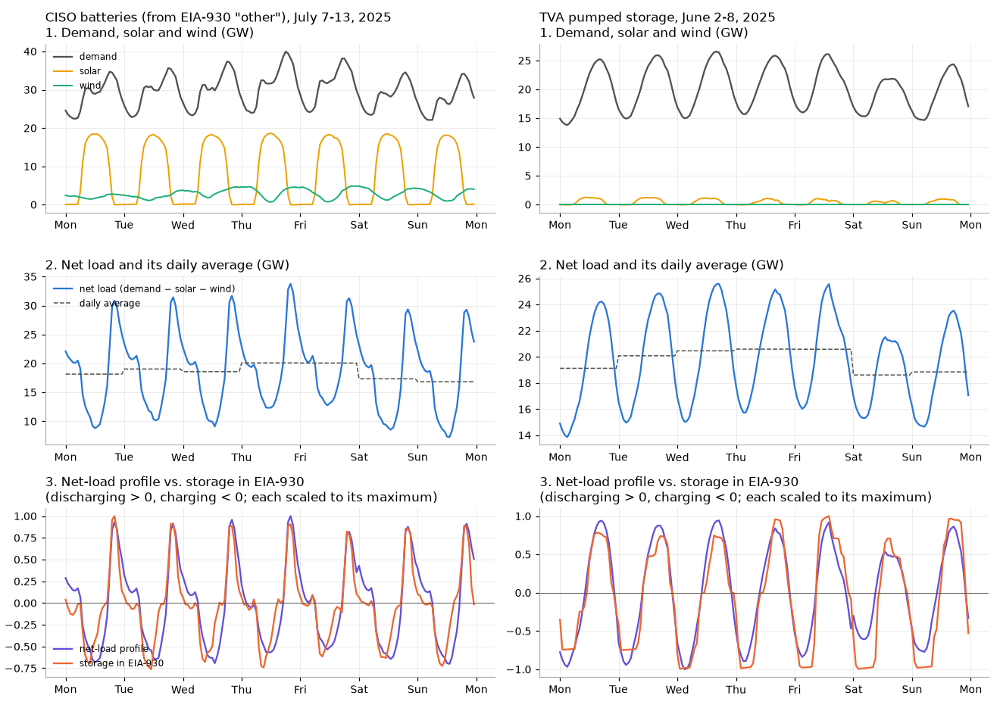

## Shaping EIA-only without generator-specific profiles

One of the primary innovations of the Open Grid Emissions Initiative is its approach to assigning an hourly profile to monthly generation and fuel data reported in EIA-923. This is accomplished using hourly regional generation fleet data reported in EIA-930 (also known as the “Hourly Electric Grid Monitor”). For each regional balancing authority, EIA-930 reports the hourly net generation from all generators of each fuel category (e.g. coal, natural gas, hydro, solar, etc) in that region (which we will refer to as a “fleet”). Since we know the total net generation profile of each fleet, as well as the net generation profile reported to CEMS, we can calculate a residual profile that should theoretically reflect the aggregate profile of all generators in a fleet that do not report to CEMS. This fleet-specific profile can then be used to shape the monthly total data reported to EIA-923. Although this method still has several issues (which will be discussed later), we believe this to be the best currently available method for imputing these shapes, since it is based on observed data.

> Definition: a group of all subplants in a balancing authority that have the same fuel category (e.g. coal subplants in MISO) are referred to as a "fleet"

## Calculating a residual profile

At its most basic, calculating a residual hourly profile that reflects the generation profile of the part of each fleet that does not report to CEMS involves subtracting the hourly CEMS net generation profile for that fleet from the hourly total EIA-930 profile for that fleet.

To prepare the EIA-930 data for this calculation, it is cleaned and reconciled using a process described elsewhere in this documentation. To prepare the CEMS data for this calculation, first all previously-shaped data (CEMS, partial CEMS subplant, and partial CEMS plant) is added together, and aggregated by balancing authority and fuel category. Each subplant may be assigned one of 41 unique primary fuels, but EIA-930 only reports generation totals for 8 broader fuel categories (solar, wind, hydro, nuclear, natural gas, coal, petroleum, and other), each specific energy source type is mapped to one of these broader categories for aggregation.

In some cases, the CEMS profile for a fleet will be larger than the EIA-930 fleet total. This may be a result of several inconsistencies in the way that generation data is reported to EIA-930 versus EIA-860 and EIA-923. These issues are discussed in more depth below, but include instances when generation is reported to a different balancing authority, is categorized under a different fuel category, or not reported to EIA-930 because the plant it is associated with is connected to the distribution grid, rather than the transmission grid.

In these cases when CEMS generation is greater than EIA-930 generation, the residual profile would be negative. Thus, we also calculate a shifted residual profile by shifting the CEMS profile down by a constant amount such that the minimum residual value would be zero. This approach preserves the shape of the residual profile while ensuring no negative values. This approach works well when only small shifts are needed (relative to the magnitude of the EIA-930 profile) to correct the data, but in other cases, this approach would lead to residual profiles that are much larger than the original EIA-930 profile. In such cases the shifted residual profile is not used.

For non-emitting resources like wind and solar, which report data to EIA-930 but not CEMS, the residual profile will always equal the reported EIA-930 value (since the CEMS profile is zero).

### New EIA-930 energy sources

Since 2024, BAs have started to report some resources separately in EIA-930: pumped storage (previously part of hydro), solar and wind with integrated battery storage (previously part of solar and wind), and battery storage, other energy storage, and geothermal (previously part of other). See [EIA-930 Data](../Data%20Cleaning/EIA-930%20Data.md#energy-sources). BAs switched at different times, so for each BA and month, a new energy source is only treated separately in the months after the BA's [cutover date](../Data%20Cleaning/EIA-930%20Data.md#cutover-dates) for it. In the month of the cutover and before, it is added back to the energy source that included it before, as the BA reported it then.

In the months after a cutover:
- Geothermal plants are shaped using the BA's EIA-930 geothermal profile. Before a cutover, and in BAs that don't report geothermal, geothermal gets a flat profile (see below).
- The hydro, solar, wind, and other profiles no longer include the resources reported separately. For example, the "other" profile of a BA that reports battery storage no longer includes battery charging and discharging, so it better represents the other resources it is used to shape.
- Solar and wind at plants with integrated battery storage are shaped with the BA's solar or wind profile. The EIA-930 profile of solar or wind with integrated battery storage reflects the combined output of the generator and its battery, so it isn't used directly for either.
- Energy storage is shaped with its own charging and discharging profiles (see [Energy storage profiles](#energy-storage-profiles) below), so the EIA-930 storage categories aren't used as residual profiles.

To calculate residual profiles in these months, CEMS data for subplants in a category that the BA reports separately (for example, a battery at a plant that reports to CEMS) is subtracted from the EIA-930 profile of that category, rather than from the original category.

EIA-930 profiles only describe when positive generation happens, so negative EIA-930 values (net load, such as station use at night or storage charging) are set to zero before the residual is calculated. A fleet-month in which EIA-930 generation is zero in every hour has no shape to give, so it is treated as missing and gets one of the imputed profiles described below. This includes energy sources that a BA doesn't report in EIA-930 that month (the [physics-based reconciliation](../Data%20Cleaning/Physics-based%20Reconciliation.md) keeps these at exactly zero) and months with only negative values.

## Imputing missing wind and solar profiles

For BAs where wind or solar generation is reported in EIA-923, but not in EIA-930, we use wind or solar data from neighboring BAs to infer the wind or solar profile. Specifically, we use data from all directly-interconnected balancing authorities (other BAs with which the BA exchanges electricity) that are located in the same EIA-930-identified region, and which are located in the same local timezone. This approach minimizes the impact of spatial variation on wind and solar resource profiles, and minimizes any impacts of sunrise/sunset times on variation.

We then average together the wind or solar profiles from these neighboring regions to use as a proxy profile for the wind or solar profile in the region in question. Averaging these profiles without first normalizing them more heavily weights the shape of the profile for regions where there is a greater volume of generation from these sources.

If no data is available from neighboring BAs, we instead use a national average wind or solar profile. This approach is less accurate but only needs to be applied in a few situations. Data quality metrics about the number of BA-months where each method is applied, and validation metrics evaluating how well each of these imputation methods perform when cross-validated with known data are published alongside the dataset.

## Use of other profiles

If neither a good-quality residual profile or shifted residual profile are available for a given fleet, we first fall back to using the total EIA-930 fleet profile to estimate the profile. If a complete EIA-930 fleet profile is not available, we fall back to using the fleet profile for those plants that report to CEMS. Both of these approaches assume that plants of a certain fuel type in a given region generally operate in similar patterns (which may not always be the case). The EIA-930 profile is preferred to the CEMS profile because we assume that the average profile of the entire fleet better represents any single member of the fleet than the profile of a non-random sample of the fleet (CEMS data only represents relatively large generators > 25MW).

If all other attempts at imputing a reasonable hourly profile fail, we assign a flat hourly profile to the data (which is functionally the same as using a monthly average value). For certain fuels, like geothermal, nuclear, biomass, and waste, which tend to run as baseload resources, this may be a reasonable assumption.

Any fleet-month with negative net generation gets a flat profile regardless of the profile selected for it, since a profile of when positive generation happens can't describe a negative monthly total. Energy storage is the exception (see below).

A flat profile is also used for any month whose selected profile has no positive values (for example, very small EIA-930 values that round to zero), since such a profile can't be converted to shares of the monthly total. Shaping never changes the monthly totals reported to EIA-923: the shaped hourly data are checked against them, and the pipeline stops if they don't match.

## Energy storage profiles

There is currently no reported data that describes the dispatch of individual storage resources on an hourly basis. Storage doesn't report to CEMS, and the highest granularity data that is available for individual storage resources is the monthly charge and discharge reported in EIA-923. Hourly net storage dispatch data is increasingly being reported in EIA-930, which is currently the primary source of information for imputing hourly storage dispatch profiles. However, the EIA-930 data is reported as an aggregate number for the entire storage fleet of each type, meaning it masks the individual variation in storage dispatch patterns. So for now, hourly storage data is shaped based on the assumptions that all storage resources are dispatched with the same profile in each BA and storage category, and that this profile matches the aggregate profile of the entire fleet.

This approach is also used for battery storage at plants where other units report to CEMS, since it isn't operated like those units (see [Shaping Partial CEMS Plant Data](Shaping%20Partial%20CEMS%20Plant%20Data.md)). Compressed air storage that burns natural gas when discharging reports to CEMS as a combustion unit, so it uses its own CEMS data.

For each BA, storage category and month, the method has four steps:
1. Assign each storage subplant to a storage category.
2. Identify the correct storage profile to use from EIA-930, if available, and check for anomalies in the reported profiles.
3. Where the BA has no usable profile of its own, impute one based on the BA's net load profile (or, for BAs without EIA-930 demand data, the national average).
4. Shape the monthly charge and discharge, and calculate hourly net generation.

**1. Storage categories.** The categories follow the EIA-930 energy sources, so that each storage subplant can be matched with the EIA-930 series that includes it:

| Category | Storage subplants |
|---|---|
| Pumped storage | Prime mover PS |
| Storage integrated with solar (or wind) | Storage at plants with hybrid or co-located storage (see [Energy Storage](../Data%20Aggregation/Energy%20Storage.md#storage-categories)) that have solar (or wind) generators. These are the same plants whose solar and wind count as "with integrated battery storage" in EIA-930. |
| Battery storage | All other storage |

**2. Storage profiles from EIA-930.** A BA's profiles come from one of three kinds of EIA-930 series. In each, discharging is the positive part and charging the negative part of the hourly values.
- *Battery and pumped storage series.* These are used in the months after the BA's [cutover date](../Data%20Cleaning/EIA-930%20Data.md#cutover-dates). In EIA-930, battery and other non-pumped storage can be reported in any or all of three EIA-930 energy sources: battery storage, other energy storage (e.g. flywheels), or unknown energy storage. The OGE pipeline combines these three series into one battery storage profile. Discharging and charging are split for each series before adding them up, since some BAs (e.g. ERCO and AZPS) report discharging as battery storage and charging as unknown energy storage.
- *Solar (or wind) with integrated battery storage.* This profile represents the combined output of the generators and their batteries, so the storage dispatch profile has to be backed out of it. The generators' part is estimated with the BA's plain solar (or wind) profile, scaled so that its monthly energy equals the combined series plus the batteries' monthly losses (charging minus discharging, from EIA-923). This is subtracted from the combined profile, leaving the batteries' net generation. Months in which the combined series or the solar (or wind) profile add up to zero or less are skipped.
- *"Other", for BAs that still report batteries there.* Until a BA switches to reporting EIA-930's [new energy sources](../Data%20Cleaning/EIA-930%20Data.md#energy-sources), battery storage is generally reported in EIA-930's "other" category. In CISO, batteries make up most of "other", which clearly shows both charging and discharging, so CISO's "other" is used for its batteries until CISO reports them separately. The rest of "other" (mostly geothermal and biomass) is assumed to be flat within each month. Its size is uncertain, so it is set so that the remaining series discharges and charges in the same ratio as CISO's batteries in EIA-923. In these months, OGE's "other" fleet in CISO gets an imputed profile instead of the "other" profile, so that the same data doesn't shape both.

Some of these series only cover a few batteries, report only one direction, or aren't storage at all, so a BA's own profile is only used in a month if it passes three checks:

1. Discharge:charge ratio. Generally, the discharge:charge ratio should be close to the storage resource's roundtrip efficiency, which for many batteries is in the 0.8-0.9 range. Over time, it is always less than 1.0, but within a single month, energy stored at the start or end of the month can push it slightly above 1.0. However, because the EIA-930 data represents the aggregate of many batteries, which could be dispatching in opposing directions, the actual ratio in practice can be much lower (for example, if one battery charged while another discharged, we'd see an aggregate net dispatch profile of zero). Thus, the first check is that this ratio is at most 1.1, which provides a small buffer for this and for data irregularities. This only applies to directly-reported storage categories, and not profiles that are derived from others.
2. Daily balance. This checks that there is both charging (negative generation) and discharging (positive generation) in at least 50% of the days in a month. This check is based on an assumption that today's storage fleet is generally operating on a diurnal cycle, and not providing primarily long-duration storage. To qualify as a day with both charge and discharge, the smaller of the two (either charge or discharge on a given day) has to be at least one-tenth of the larger, which prevents misidentifying a balanced day based on a single hour blip in either direction.
3. Volume. This checks that the profile represents a meaningful share of the storage it shapes. Some EIA-930 BAs' storage profiles appear to represent a small number of batteries, with a profile that looks different from a smoother aggregate profile. This check prevents a single-battery profile from being used to shape an entire fleet. This checks that the absolute dispatch volume in EIA-930 is at least 20% of the EIA-923 absolute dispatch.

Some BAs (in 2025, ISNE batteries and pumped storage, and LDWP pumped storage) report no charging at all in EIA-930, presumably because they include it in demand. For these, the discharging profile is used if it passes the volume check against EIA-923 discharging, and the charging profile is imputed.

**3. Imputed profiles.** Where a BA has no usable profile of its own for a direction and month, the first available of these is used:
1. For storage integrated with solar or wind: the BA's battery storage profile (from its battery, unknown and other energy storage series).
2. A profile based on the BA's "net load."
3. For BAs without EIA-930 demand data: the national average profile, aligned by local standard time. As for wind and solar, the profiles aren't normalized before averaging, so BAs with more storage weigh more.
4. A flat profile.

Storage tends to charge when net load (demand minus solar and wind) is low, for example pumping water at night or charging batteries with midday solar, and to discharge when net load is high. This is because storage is generally dispatched economically, and prices tend to be lower when there is more solar and wind being generated, and higher during peak demand times. So for each BA and local day, OGE calculates net load from the BA's EIA-930 demand, solar and wind, and subtracts each day's average net load. Hours above the average get a discharging profile proportional to how far above they are, and hours below it a charging profile proportional to how far below. Compared with the storage that BAs report in 2025, these profiles match the hourly timing of storage well (correlations of 0.84 to 0.88 for pumped storage in DUK, SOCO and TVA, and 0.73 to 0.91 for batteries in AZPS, CISO, ERCO and IPCO), and better than the profiles of neighboring BAs in most BAs where both could be compared. They are broader than actual battery operation, which concentrates discharging in the hours of highest net load, but the monthly charge and discharge still come from EIA-923.

**4. Hourly net generation.** The monthly charge and discharge are shaped with the charging and discharging profiles, and hourly net generation is the shaped discharge minus the shaped charge. Some storage resources report a monthly net generation that isn't equal to their discharge minus their charge (see [Energy Storage](../Data%20Aggregation/Energy%20Storage.md#data-quality)). In those months, the difference is treated as under-reported energy, and added to the charge (if net generation is lower) or to the discharge (if it is higher) before shaping. This scales the shaped values in that direction, rather than shifting every hour, and keeps the reported monthly net generation. The discharge of pumped storage with natural inflow is blank in EIA-923, so for shaping it is estimated as the net generation plus the charge. Only hourly net generation is published, not hourly charge and discharge.

In data years before 2025, no BA reports storage separately in EIA-930, so storage is shaped with net-load profiles, except for CISO's batteries, which use CISO's "other" in years when it passes the checks above.

## Known issues with using EIA-930 data for hourly profiles

One challenge of comparing data from EIA-860/923 to data from EIA-930 is the uncertainty about whether specific plants are members of the same fleet. EIA-860 and EIA-923 report information about which BA a plant belongs to and what fuel types it consumes, but these might not always be consistent with how balancing authorities report data to EIA-930.

We have identified three primary areas why net generation calculated from EIA-923 and CEMS might not match the net generation reported in EIA-930:

* The generation might be reported under a different balancing authority
* The generation might be reported under a different fuel code
* The generation might not be reported for generators connected to the distribution grid

**Balancing authority assignment**

According to the [EIA-930 instructions](https://www.eia.gov/survey/form/eia_930/instructions.pdf), there are two primary ways that an individual generator can be assigned to a balancing authority:

* The “physical” definition would assign a generator to a balancing authority based on whether that generator is “physically embedded within the tie line boundary of [a] balancing authority.”
* The “commercial” definition would assign a plant to the balancing authority that owns, operates, and/or dispatches that generator.

Our understanding is that the BA reported in EIA-860 represents the plant’s commercial BA, while the plant would be reported in EIA-930 as part of its physical BA.

**Fuel code assignment**

The primary fuel codes assigned to each plant in the OGE pipeline may not match the generator primary fuel code used by the balancing authority. Thus, it is possible that the set of plants classified as “natural gas”, for example, in EIA-930 may be different from the set of plants that we classify as natural gas.

**Inclusion of distribution-connected plants**

Our understanding is that the data published in EIA-930 only reflects plants have metered telemetry that communicates with the grid operator. In many cases, this may exclude plants that are connected to distribution grids, rather than directly interconnected at the transmission level. Thus, it is possible that the set of plants reported in EIA-930 may not reflect the full set of plants that report to EIA-923 (which includes plants that are connected to distribution grids as well).

## Shaping the Monthly data
Once an hourly profile for each fleet-month has been calculated, it is converted to a percentage of the monthly total value. These percentages are then multiplied by each monthly total value to get the hourly profile for each subplant. This approach ensures that the shaped hourly values, when aggregated back to the monthly level, will equal the total reported monthly value that was shaped.

When exporting hourly, plant-level data, we export hourly data for each individual plant. However, this data is too large to hold in memory, so this data is created for each BA and then exported. When calculating hourly, fleet-level outputs, we first aggregate the EIA-923 data to the fleet level before assigning a shape. 

### Local timezones and hourly profiles

Each BA-fuel hourly profile is calculated and expressed on the BA's own local calendar (the timezone the BA uses when reporting to EIA-930). However, a BA may span multiple timezones, so will contain plants whose local timezone does not match the reporting timezone of the BA. This mismatch means that any plant whose timezone does not match the BA's timezone will end up with an hour at the beginning or end of the year that is missing a profile.

For fleet-level (power sector) outputs, we always use the BA's own local timezone, since these outputs are aggregated to the BA level regardless of the timezones of the individual plants that make them up.

For plant-level outputs, using the BA's local timezone for every plant would mean that a plant located in a different timezone than its BA is assigned an hourly profile whose month and year boundaries don't line up with that plant's own local time (for example, a plant in `America/New_York` located within a `US/Central`-reporting BA). To keep plant-level exports internally consistent, plants located in a different timezone than their BA are shaped using their BA's profile reassembled onto their own local timezone: the BA's absolute (pre-percentage) hourly values are matched to the plant's own local months, borrowing values from the adjacent BA-local month where a local month boundary falls in the middle of a BA month, and are only then converted to a percentage of the plant's own local-month total. This ensures that a plant's hourly, monthly, and annual totals are always calculated within a single, consistent local year, rather than a mix of two different local years.

At the true start and end of the year, there is no adjacent-year BA data to borrow from (the pipeline only ever holds one year of data at a time), so these hours are instead forward/backward-filled from the nearest available hour. This fill is deliberately bounded to a small number of hours (wide enough to cover the largest timezone offset actually seen between a BA and its plants): if a plant's own profile is missing more hours than that at the edge, or has a gap somewhere else in the year, those hours are left missing rather than silently filled, so a genuine data problem stays visible instead of being masked.

For BA-level outputs, plant data is aggregated to the BA level. Because some BAs have plants that span multiple timezones, this would result in the BA timeseries having more hours than the BA local time year. Thus, only the hours in the BA local time are kept. One limitation of this approach is that the edge hours (the first and last hour of the year), will only contain data for the subset of plants that were generating in that BA's local time. In other words, that hour may have incomplete data. To address this, the data pipeline would have to ingest data from several hours on either side of the current year. 

## Future Work, Known Issues, and Open Questions
- Infer missing hourly profiles for hydro generation ([details](https://github.com/singularity-energy/open-grid-emissions/issues/37))
- Hourly storage profiles aren't limited by the capacity of the storage they shape. A profile that concentrates a month's charging or discharging in a few hours, for example a net-load profile on days with unusually large swings in net load, can give hourly charging or discharging above the fleet's capacity. In 2025, this happens in about 0.4% of storage fleet-hours, by up to about 1.75 times capacity in large fleets (for example, PJM's pumped storage during the June heat wave). Monthly totals and the timing within each day are unaffected. A future version could cap hourly values at the fleet's EIA-860 capacity and move the excess to the fleet's other charging or discharging hours in the month.
- Batteries backed out of solar or wind with integrated battery storage pass the checks above in some BAs with small fleets (for example CPLE, SOCO, TEC and TVA, with 20 to 50 MW of batteries) even though their daily shapes are less clear, for example with two daily peaks or charging at night. The checks test whether a series looks like storage, not whether its timing is plausible.
- Net-load profiles for storage use the solar and wind that EIA-930 reports in each BA's physical territory. Some BAs dispatch storage against a commercial portfolio that differs from it. For example, PGE reports no solar or wind in EIA-930, but has solar and wind in its portfolio, so its net-load profile is just its demand. A future version could use the solar and wind assigned to each BA in OGE instead (PGE's own batteries are shaped with its own EIA-930 profile in 2025, so this doesn't affect PGE now).
- Publish hourly energy storage charge and discharge ([details](https://github.com/singularity-energy/open-grid-emissions/issues/59))
- Should we model hourly shapes for missing peaker or load following genration? ([details](https://github.com/singularity-energy/open-grid-emissions/issues/96))
- Improve imputation of missing wind and solar generation profiles ([details](https://github.com/singularity-energy/open-grid-emissions/issues/171))